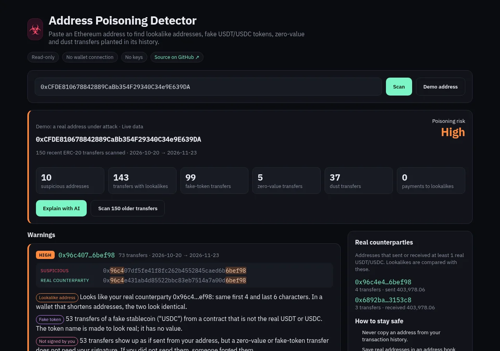

# Address Poisoning Detector

**Live demo:** https://address-poisoning-detector.vercel.app

Paste an Ethereum address and see whether someone is trying to "poison" its transaction history: lookalike addresses, fake USDT/USDC tokens, zero-value transfers and dust. Every warning explains, in plain English, what the attacker is doing.

It is **read-only**: it only reads public blockchain data. There is no wallet connection, nothing is signed, and no private keys or seed phrases are ever asked for.



## What is address poisoning?

Most wallets shorten addresses to something like `0x96C4…Ef98`. An attacker who sees you pay `0x96C4e431…6bEf98` generates a vanity address with the same first and last characters (`0x96C407Df…6bef98`) and then plants it in your history:

- a **zero-value transfer** of real USDT/USDC (anyone can create one, even "from" your address, because a 0 transfer needs no signature),
- a **dust transfer** of a tiny real amount, or
- a transfer of a **fake token** named "USDC" or "UЅDТ" (Cyrillic letters, invisible characters) that mirrors the amount you really sent.

The next time you copy "the last address you paid" from your history, you copy the attacker's. This has cost people millions of dollars.

## What the detector checks

| Flag | Meaning |
| --- | --- |
| Lookalike address | Shares at least 3 leading and 3 trailing hex characters (7+ in total) with a real counterparty, with the scanned address itself, or with another suspect. |
| Fake token | A token whose symbol or name collapses to `USDT`/`USDC` after removing homoglyphs and invisible characters, but which is not the official contract. |
| Zero value | A transfer of exactly 0 official USDT/USDC. |
| Not signed by you | A zero-value or fake-token transfer that appears to be *sent* by the scanned address. |
| Dust | Less than 0.01 official USDT/USDC from an address you never really transacted with. |
| Sent to lookalike | Real USDT/USDC was sent to a lookalike address. This is the critical case: funds were probably lost. |

"Real counterparties" are addresses that sent or received at least 1 official USDT/USDC. If two real counterparties look alike, the one that first appeared through a poisoning-style transfer is treated as the impostor.

Each suspicious address gets a severity (critical, high, medium, low), a side-by-side comparison with the address it imitates (copied characters highlighted), and links to Etherscan.

The page opens on a real mainnet address that is under an active poisoning campaign, so you can see results right away. A saved snapshot is shown instantly and replaced by live data as soon as the explorer answers.

### Optional AI explanation

"Explain with AI" sends a compact, validated summary of the findings (flags, counts, addresses, no free-form text) to a Vercel serverless function that calls Gemini (`gemini-3.5-flash-lite`). The model is told to use only that data, not to invent owners or amounts, and to give practical safety steps. The API key lives only in Vercel environment variables. Requests are rate-limited and size-capped.

## Tech

- React 19, TypeScript, Vite
- Public [Blockscout](https://eth.blockscout.com) API for ERC-20 transfers (called from the browser, no API key)
- Vercel serverless function for the optional Gemini explanation
- Vitest unit tests for the detection logic, parsing, the API handler and UI helpers
- GitHub Actions: lint, typecheck, test and build on every push and pull request

```
src/lib/address.ts    prefix/suffix matching and lookalike rules
src/lib/tokens.ts     official contracts, homoglyph "skeleton", amounts
src/lib/detect.ts     classification, real counterparties, findings and severity
src/lib/blockscout.ts paging, retries, timeouts and parsing
src/lib/explain.ts    /api/explain handler and Gemini call
```

## Limits

- Ethereum mainnet only, and only ERC-20 transfers. Native ETH dust and NFT spam are not checked.
- Only the most recent transfers are scanned (150 at a time; you can load older ones). A real counterparty older than the scan window is not known, so a lookalike may only be matched against other suspects.
- Lookalike detection compares leading and trailing characters. An attacker who copies characters in the middle only would not be caught (but would also be less convincing).
- Fake tokens are detected by name, symbol and contract address for USDT/USDC. Fakes of other tokens are not flagged.
- Very busy addresses can make the public explorer slow or rate-limited.
- No result is a security guarantee. Always check the full address before sending funds.

## Running it yourself

Requires Node.js 20.9+.

```bash
npm install
npm test
npm run dev
```

The Vite dev server also serves `/api/explain`. To try the optional explanation locally, copy `.env.example` to `.env` and set `GEMINI_API_KEY`. The detector works without it.

`npm run snapshot` refreshes the saved demo snapshot.

## Credits

Idea inspired by a public warning about "0 USDT transfer" address poisoning scams on X.

## License

[MIT](LICENSE)
